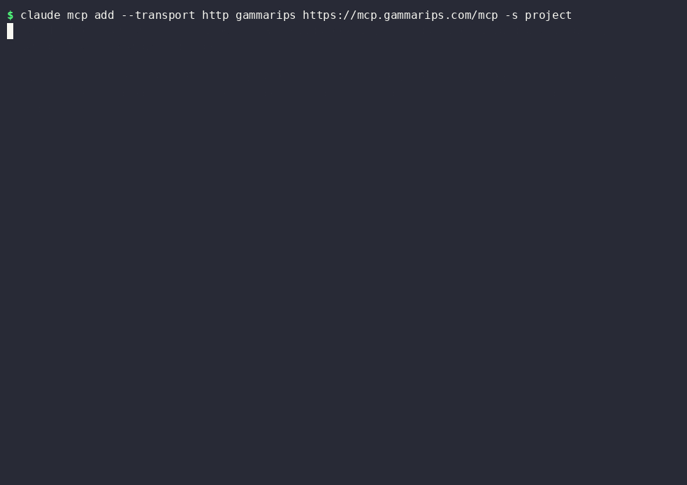

# gammarips-harness

An open-source agent workflow harness for the **GammaRips MCP** curated options dataset.

GammaRips is a data layer, not a signal service. Every trading day, the engine filters ~3,500 optionable US stocks down to a curated cohort of liquid, tradable, high-edge option contracts and serves that dataset over MCP. Your agent pulls the surviving cohort, layers its own live catalyst research (X/Twitter cashtags, filings, web search, parallel subagents), and builds a deterministic trade plan with historical MFE/MAE excursion data.

## The Product: Curated Options Dataset via MCP

Instead of dumping noisy raw chains into an LLM context window, GammaRips filters the US options universe down to the daily cohort of surviving contracts that pass strict quantitative and liquidity gates:

- **Mid Price:** `Mid >= $1.00`
- **Open Interest:** `OI >= 500`
- **Delta Band:** `Delta 0.22–0.48`
- **Days to Expiration:** `DTE 10–45`
- **Volatility Edge:** `RV/IV >= 0.85` (realized volatility vs. implied volatility)

### MCP Endpoints

Connect any MCP-compatible agent (Claude Code, Grok, Codex, Cursor, or custom runners):

- **Pro (OAuth):** `https://mcp.gammarips.com/pro`
- **API Key (Bearer):** `https://mcp.gammarips.com/mcp` with header `Authorization: Bearer gr_live_...`
- **Free Preview (No Key):** `https://mcp.gammarips.com/mcp` (serves the daily report, regime context, market calendar, playbooks, and cohort preview)

## 3-Step Agent Workflow

### 1. Pull the Daily Cohort (`get_pool`)
Fetch today's surviving tradable option contracts and their point-in-time volatility and liquidity metrics (`rv_iv_ratio`, `open_interest`, `mid_price`, `delta`, `dte`, and opportunity surfaces), alongside market calendar status (`get_market_calendar_status`) and VIX term-structure regime (`get_regime_context`).

### 2. Layer Your Own Catalyst Search (Bring Your Own X / Web Agent)
GammaRips handles the quantitative options filtering; you bring the catalyst layer. Have your agent (Claude Code, Grok, Codex, Cursor) spin up parallel subagents or live X/Twitter and web search — for example, Grok searching live `$TICKER` cashtag chatter, SEC/FDA regulatory filings, or unpriced catalysts — to debate and rank the surviving contracts.

### 3. Build the Trade Plan / Execute
Size the position against your risk budget, set deterministic bracket exits (profit target, stop loss, and mandatory time-stop) using historical MFE/MAE excursion distributions (`query_outcomes` and `replay_contract`), pre-register the decision in `eval/funnel-log.jsonl`, and optionally route the order to your own broker MCP.

---

## Quick Start

### Try the free preview (no key, 10 seconds)

```bash
claude mcp add --transport http gammarips https://mcp.gammarips.com/mcp
```

Ask your agent for today's brief to inspect the market calendar, VIX regime context, daily report, and cohort preview.



### Connect with Pro (OAuth or API Key)

1. **Subscribe** at [gammarips.com/pricing](https://gammarips.com/pricing) and create an API key at [gammarips.com/account](https://gammarips.com/account) (or authenticate directly via OAuth at `https://mcp.gammarips.com/pro`).
2. **Export your key** for `.mcp.json`:
   ```bash
   export GAMMARIPS_MCP_KEY="gr_live_..."
   ```
3. **Or install as a Claude Code plugin:**
   ```
   /plugin marketplace add DevDizzle/gammarips-harness
   /plugin install gammarips@gammarips
   ```
4. **Run the daily skills:**
   ```
   /trade    Step 1–3 morning workflow: pull cohort, layer catalysts, build exit plan
   /review   After the close: score every cohort contract with MFE/MAE outcomes
   /coach    On demand: referee trading behavior against your written rules
   ```

## Repository Layout

| Path | Description |
|---|---|
| `CLAUDE.md` | Agent instructions: dataset specification, 3-step workflow, and core rules |
| `.mcp.json` | Streamable HTTP MCP config (`https://mcp.gammarips.com/mcp` with `Bearer ${GAMMARIPS_MCP_KEY}`) |
| `docs/TRADING-DOCTRINE.md` | Risk rules, hard exclusions, sizing framework, and deterministic exit discipline |
| `docs/OPERATIONS.md` | MCP endpoints (`/pro` OAuth and `/mcp` Bearer key), session timing, and failure handling |
| `.claude/skills/` | Agent procedures: `trade`, `review`, `coach`, `wiki-distill`, `ste100` |
| `wiki/` | Claim-tagged research notes (`findings/`, `literature/`) and index registries |
| `eval/` | Your local dataset: `funnel-log.jsonl`, `trades.jsonl`, `behavior-ledger.jsonl` |
| `scripts/` | Validators (`funnel_log.py`, `behavior_log.py`, `lint.py`) and evaluators (`edge.py`, `skill_eval.py`) |

## Not Investment Advice

GammaRips is a financial data vendor. Everything in this repository is for educational and research purposes, configured for paper trading by default. Nothing here constitutes investment advice. Trade your own capital at your own risk.
